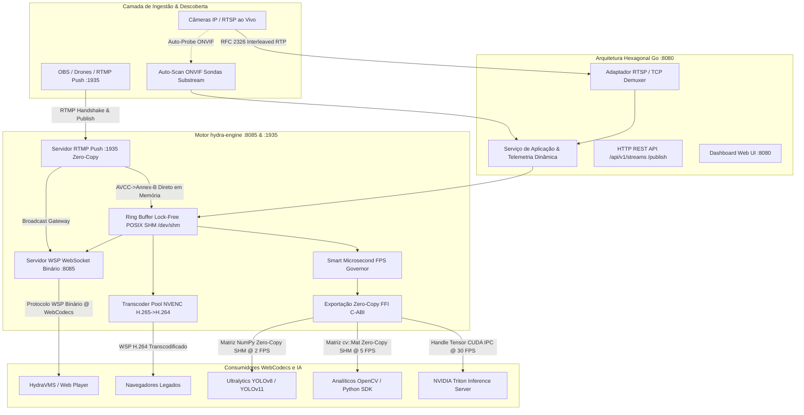

# HydraStream

> **Pipeline de alta performance e consumo zero de CPU para decodificação e distribuição de frames de câmeras para visão computacional e Triton analytics em Go & Rust.**

[**English**](README.md) | [**Português do Brasil**]

[](LICENSE)
[](https://go.dev/)
[](https://www.rust-lang.org/)
[](https://developer.nvidia.com/)
[](crates/hydra-engine)

---

## O Problema

Em sistemas de visão computacional em grande escala, rodar múltiplos analíticos sobre o mesmo fluxo de câmeras gera três grandes gargalos de desempenho:

1. **Decodificação Redundante no OpenCV:** Cada script ou container decodifica o stream H.264/H.265 do zero usando OpenCV/FFmpeg, saturando a CPU do servidor.
2. **Re-Conexões Repetidas no MediaMTX:** Múltiplos consumidores abrem conexões RTSP/WebRTC redundantes contra a mesma câmera, sobrecarregando a rede.
3. **Falta de Controle de Cadência (Sem FPS Control):** Analíticos (ex: LPR, reconhecimento facial, detecção de intrusão) tentam processar frames no FPS total da câmera (30 FPS) quando precisam de apenas 2 a 5 FPS, desperdiçando 90% da capacidade computacional.

---

## A Solução

O **HydraStream** atua como um multiplexador de vídeo Headless centralizado e motor de gestão de pipeline no servidor (*um único feed de câmera alimentando múltiplos analíticos com cadências controladas*):

- **Gestão Passiva Puramente no Servidor:** O HydraStream **jamais altera ou manipula a câmera IP ou o encoder de origem** (ele não altera o FPS da câmera, nem resolução ou bitrate da fonte). O stream de origem permanece 100% intocado. Toda a amostragem de frames, seleção de matrizes e telemetria ocorrem exclusivamente do lado do servidor em memória.
- **Engine Headless Orientada a API:** O HydraStream expõe uma API REST limpa (`POST /api/v1/streams`) projetada para ser controlada por plataformas terceiras, VMSs ou portais de clientes.
- **Arquitetura Dual-Engine Modular:**
  - **Módulo CPU:** Usa Go/Rust + FFmpeg para alta taxa de processamento em nós puramente CPU.
  - **Módulo GPU (NVIDIA):** Usa NVDEC + CUDA IPC + NVIDIA Triton Inference Server para aceleração por hardware e passagem de tensores zero-copy na VRAM da GPU (com detecção dinâmica da RTX 5090/4090/A100).
- **Canal Único de Ingestão & Auto-Descoberta ONVIF:** Conecta ao stream RTSP **1 única vez** via RFC 2326 TCP demuxing. O probe RTSP inteligente varre automaticamente as portas ONVIF para descobrir credenciais, perfis e mapear o Substream nativo da câmera.
- **Ingestão Nativa RTMP Push em Rust (:1935):** Servidor RTMP assíncrono integrado diretamente ao `hydra-engine`. Uma aplicação externa (OBS Studio, drone, encoder de hardware) solicita o endpoint `POST /api/v1/streams/publish`, recebe a URL RTMP e o fluxo é imediatamente demuxado para NALUs Annex-B gravados direto no `/dev/shm` e distribuídos 1:N sem overhead.
- **Motor de Mídia Nativo em Rust (WSP :8085):** Substitui dependências externas de servidores RTSP (como MediaMTX) por um servidor WebSocket binário de alta cadência (`hydra-engine`), entregando NALUs Annex-B diretamente ao W3C WebCodecs no frontend do VMS com latência ultra-baixa (< 16ms).
- **Transcodificação Dinâmica NVENC sob Demanda:** Fluxos de alta resolução H.265/HEVC são transcodificados dinamicamente para H.264 via hardware em qualquer GPU NVIDIA ativa (`hevc_cuvid` -> `h264_nvenc`) sem qualquer sobrecarga de CPU do servidor, com auto-desligamento inteligente quando os clientes desconectam.
- **Integração Direta com Ultralytics & OpenCV:** Entrega matrizes prontas (`numpy.ndarray` / `cv::Mat`) diretamente para o Ultralytics YOLO (`model.predict(frame)`) ou OpenCV, eliminando o `cv2.VideoCapture`.
- **FPS Governor Inteligente por Consumidor:** Permite que cada analítico registre seu FPS alvo (ex: Analítico A @ 2 FPS, Tracker @ 15 FPS), descartando frames sem custo de CPU.
- **Detecção Automática de Hardware e Topologia:** Lê em tempo real os núcleos de CPU da máquina, VRAM da GPU NVIDIA e se adapta de ambiente standalone local para cluster Kubernetes.

---

## Arquitetura Geral



---

## Benchmarks de Performance (Hardware Físico Real)

Medidos em tempo real em uma **NVIDIA GeForce RTX 5090 (32GB VRAM)** + **Processador Linux de 16 Núcleos** com **3 analíticos concorrentes** processando vídeo 1080p RGB:

| Arquitetura do Pipeline | Throughput de Fan-Out | Latência (Δt) | Transferência de Memória | Ganho Real |
| :--- | :--- | :--- | :--- | :--- |
| **1. Tradicional (OpenCV VideoCapture)** | 1.281,3 FPS | 2,34 ms | Cópias de Host CPU | `1.0x (Referência)` |
| **2. HydraStream Modo CPU (POSIX SHM)** | **5.775,9 FPS** | **0,52 ms** | **Zero-Copy RAM** | **4.5x Mais Rápido** |
| **3. HydraStream Modo GPU (RTX 5090 CUDA)** | **18.512,2 FPS** | **0,16 ms** | **107,25 GB/s (VRAM Direta)** | **14.4x Mais Rápido** |

> *Para rodar esta bateria comparativa na sua própria máquina:*
> ```bash
> make benchmark-compare
> ```

---

## Control Plane & API de Gestão

O HydraStream inclui uma **API REST** de alta performance permitindo configurar streams dinamicamente, ajustar taxas de amostragem por analítico e acompanhar telemetria em tempo real:

- **Documentação Swagger UI Interativa:** `http://localhost:8080/swagger/`
- **Especificação OpenAPI 3.0:** `http://localhost:8080/swagger/doc.json`

### Tabela de Endpoints

| Método | Endpoint | Descrição |
| :--- | :--- | :--- |
| `GET` | `/api/v1/streams` | Lista os streams ativos (busca, filtro de tenant, ordenação, paginação) |
| `POST` | `/api/v1/streams` | Registra um novo pipeline de stream RTSP ou vídeo |
| `GET` | `/api/v1/streams/{id}` | Retorna detalhes do stream e consumidores cadastrados |
| `DELETE` | `/api/v1/streams/{id}` | Encerra a ingestão e remove o stream |
| `GET` | `/api/v1/streams/{id}/ingest` | Telemetria ao vivo da ingestão RTSP (FPS, bitrate, erros de socket) |
| `PATCH` | `/api/v1/streams/{id}/consumers/{type}` | Atualiza dinamicamente o FPS alvo ou formato do analítico |
| `GET` | `/api/v1/streams/{id}/recordings/fragments` | Lista segmentos/fragmentos de gravação de vídeo de um stream |
| `POST` | `/api/v1/streams/{id}/recordings/fragments` | Envia e despacha fragmentos de vídeo gravados (Multipart / JSON / Binário) |
| `GET` | `/api/v1/streams/{id}/recordings/fragments/{id}` | Download / streaming do trecho gravado com suporte a HTTP 206 Range |
| `POST` | `/whep/{stream_id}` & `/api/v1/streams/{id}/whep` | Negociação de SDP Offer WebRTC HTTP Egress Protocol (WHEP) |
| `OPTIONS` | `/whep/{stream_id}` & `/api/v1/streams/{id}/whep` | Preflight CORS e capacidades WHEP |
| `PATCH` | `/whep/{stream_id}/sessions/{session_id}` | Troca de candidatos Trickle ICE WHEP |
| `DELETE` | `/whep/{stream_id}/sessions/{session_id}` | Encerramento de sessão WHEP |
| `GET` | `/api/v1/telemetry/stats` | Telemetria do Control Panel e histórico dos gráficos SVG ao vivo |
| `GET` | `/api/v1/info` | Leitura dinâmica do hardware (modelo da GPU, VRAM, modos de aceleração) |
| `GET` | `/api/v1/cluster/topology` | Topologia e hardware do nó local (CPU, IP, GPU e memória) |
| `GET` | `/healthz` & `/readyz` | Probes de liveness e readiness para Kubernetes |
| `GET` | `/metrics` | Exportador de métricas para Prometheus |

---

## Estrutura do Repositório

```text
HydraStream/
├── cmd/
│   └── hydrastream/        # Ponto de entrada do Control Plane em Go
├── crates/
│   └── hydra-engine/       # Motor Data Plane em Rust (POSIX SHM, FPS Governor, C-ABI)
│       ├── src/
│       │   ├── shm.rs      # Ring buffer circular atômico lock-free (/dev/shm)
│       │   ├── governor.rs # Smart microsecond FPS Governor
│       │   ├── pipeline.rs # Pipeline ponta-a-ponta de fan-out
│       │   └── ffi.rs      # Bindings FFI em C para Go e Python
│       └── Cargo.toml
├── internal/
│   ├── domain/             # Entidades de Domínio DDD (Stream, Consumer, Telemetry)
│   ├── ports/              # Interfaces da Arquitetura Hexagonal (UseCases, Ingestor, Repo)
│   ├── application/        # Serviços de Aplicação & telemetria dinâmica
│   └── adapters/
│       ├── primary/http/   # Handlers HTTP, Telemetria, Logs e Docs OpenAPI Swagger
│       └── secondary/
│           ├── ingest/     # Demuxer nativo RFC 2326 RTSP / TCP / RTP
│           ├── gpu/        # Detector de GPU NVIDIA em tempo real (RTX 5090/4090)
│           ├── logger/     # In-memory thread-safe Ring Buffer log collector
│           ├── memory/     # Repositório de streams em memória Thread-Safe
│           └── shm/        # Adaptador Go para inspeção de POSIX SHM
├── sdk/
│   └── python/             # SDK Python Zero-Copy (`import hydrastream`)
├── examples/
│   └── python_consumer.py  # Exemplo de consumo zero-copy com OpenCV e YOLO
├── bin/                    # Binários compilados e servidor MediaMTX local
├── Makefile                # Automação de compilação, testes, benchmark e MediaMTX
└── README.pt-BR.md
```

---

## Endpoints de Telemetria e Saúde (Observabilidade em Tempo Real)

| Endpoint | Método | Descrição |
| :--- | :---: | :--- |
| `GET /api/v1/health` | `GET` | Diagnóstico completo de integridade e prontidão dos subsistemas (RTSP, MediaMTX, SHM, NATS, GPU). |
| `GET /api/v1/telemetry` | `GET` | Payload unificado contendo saúde, métricas de hardware e sumário de erros. |
| `GET /api/v1/telemetry/hardware` | `GET` | Consumo em tempo real de CPU (núcleos/goroutines), RAM do Host/Go, VRAM/GPU Util/Temp (RTX 5090) e `/dev/shm`. |
| `GET /api/v1/telemetry/logs` | `GET` | Consulta ao Ring Buffer de logs em memória com filtros (`level`, `component`, `limit`, `since`). |
| `POST /api/v1/telemetry/logs` | `POST` | Ingestão manual de eventos diagnósticos. |
| `GET /api/v1/telemetry/errors` | `GET` | Agregação de anomalias, contagem de erros por componente e histórico recente. |
| `GET /healthz` & `/readyz` | `GET` | Probes padrão de liveness e readiness (HTTP 200 OK). |
| `GET /swagger/` | `GET` | Documentação OpenAPI / Swagger UI interativa. |

---

## Guia de Início Rápido

### 1. Iniciar o HydraStream (Control Plane & Motor WSP Rust)
```bash
make dev
```
> Inicia o Control Plane em Go em **`http://localhost:8080`** e o Motor WSP embutido em Rust em **`ws://localhost:8085`**.

### 2. Iniciar o Servidor WSP Rust Standalone
```bash
make wsp-server
```
> Inicia o servidor Tokio WebSocket dedicado para entrega binária de fluxos WSP com aceleração NVENC dinâmica na porta `8085`.

### 3. Transmitir um Padrão de Teste RTSP
```bash
make stream-sample
```
> Utiliza o FFmpeg para transmitir um feed de teste 1080p @ 30 FPS para `rtsp://localhost:8554/tenant_company_alpha/cam_entrance_01`.

### 4. Executar os Testes Unitários Go e Rust
```bash
make test
```

### 5. Ingestão Genérica 1:N e Entrega Contínua em Rust
O HydraStream opera automaticamente com entrega simultânea **1 para N**:
- **WSP Binário (`ws://localhost:8085/live/<stream_id>`)**: Exibição instantânea via WebCodecs (< 50ms de latência) com zero sobrecarga de negociação WebRTC.
- **NVENC Dinâmico (`ws://localhost:8085/live/<stream_id>?codec=h264`)**: Transcodificação sob demanda acelerada por hardware em GPUs NVIDIA para fontes H.265.
- **Zero-Copy SHM (`/dev/shm/hydra_<stream_id>`)**: Decodificado em tempo real pelo motor Rust, acessível diretamente pelos modelos YOLO e scripts de visão computacional.

### 6. Executar o Benchmark de Zero-Copy em Rust
```bash
make benchmark
```

---

## Exemplo de Consumo Zero-Copy em Python

```python
import cv2
from hydrastream import SharedMemoryReader

# Conecta ao buffer zero-copy do HydraStream com cadência de 15 FPS
reader = SharedMemoryReader(stream_id="cam_entrance_01", target_fps=15)

for frame in reader.stream():
    # Acesso direto à matriz NumPy sem custo de decodificação no Python
    cv2.imshow("HydraStream Feed", frame)
    if cv2.waitKey(1) & 0xFF == ord('q'):
        break
```

---

## Fundamentos de Engenharia & Literatura de Referência

Os pilares arquiteturais do **Data Plane & Engine do HydraStream** (`crates/hydra-engine`) foram construídos diretamente sobre os princípios da literatura de engenharia de sistemas e concorrência em Rust:

1. 📖 **"Rust Atomics and Locks" por Mara Bos (O'Reilly)**
   - **Protocolo MESI e Isolamento de Linhas de Cache:** Alinhamento estrito a 64 bytes (`#[repr(align(64))]`) em `ShmHeader` e `SlotHeader`, eliminando *False Sharing* nas caches L1/L2.
   - **Ordenação Formal Happens-Before:** Uso rigoroso de `Ordering::Release` em produtores e `Ordering::Acquire` em consumidores, garantindo consistência de memória *zero-copy*.
   - **Sincronização com Futex do Kernel (`SYS_futex`):** Espera baseada em endereço com despertar seletivo por Bitsets (`FUTEX_WAIT_BITSET` / `FUTEX_WAKE_BITSET`), eliminando a *manada tonante (thundering herd)* com 0% de uso de CPU em repouso.
   - **Concorrência Lock-Free & RCU:** Listas encadeadas com `AtomicPtr` e padrão Read-Copy-Update (`RcuConfig`) para atualizações dinâmicas de peers e metadados sem bloquear os leitores.
   - **Sincronização Híbrida Adaptativa:** `HybridMutex` de 3 estados (com até 100 iterações de *spin* via `std::hint::spin_loop()` antes da syscall) e tabela centralizada `ParkingTable`.

2. 📖 **"Effective Rust" por David Drysdale**
   - **Robustez do Type System & Enums Ricos:** Modelagem de invariantes de estado em tempo de compilação.
   - **Propagação Limpa de Erros:** Uso sistemático de `Result<T, StreamError>` e operador `?` com custo zero de runtime.
   - **Escopo Estrito de Locks (Item 17):** Delimitação atômica de seções críticas para prevenção total de *Deadlocks* e inversão de prioridade.
   - **Minimização de Visibilidade:** Encapsulamento com `pub(crate)` protegendo detalhes internos e expondo APIs limpas para C-ABI e Gateway Assíncrono Tokio.

---

## Licença

Este projeto está licenciado sob a [Licença MIT](LICENSE).
